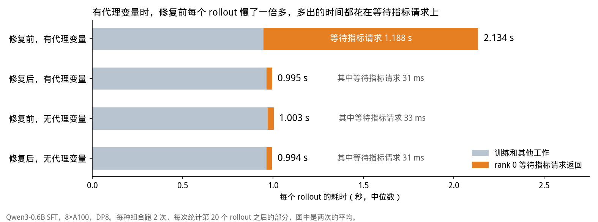
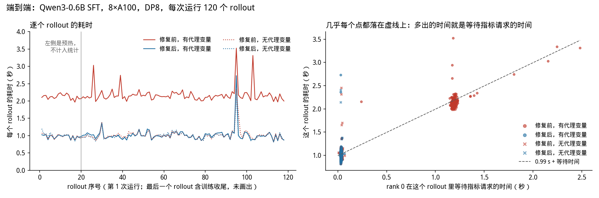
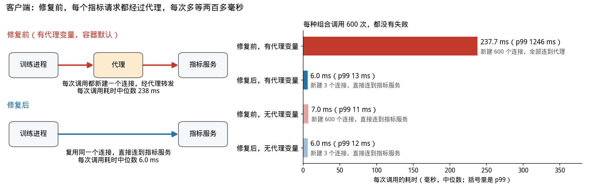
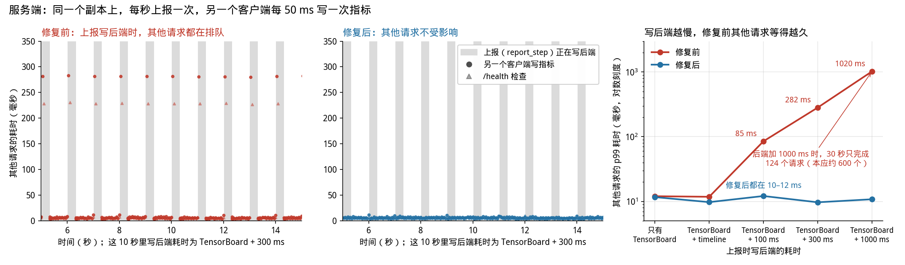

# PR #463：复现与测量

[redai-studio/Relax#463](https://github.com/redai-studio/Relax/pull/463) 做了两处修改：客户端改用一个复用连接、不读代理环境变量的 `requests.Session`；服务端把 `report_step` 写后端的工作放到线程里，不再占着事件循环。

这份材料回答三个问题：问题能不能复现，影响有多大，修复后好了多少。测量于 2026-10-27 在一台 8×A100 机器上进行（Python 3.12.3、Ray 2.58.0、requests 2.34.2、PyTorch 2.13.0）。下文的 p50 是中位数，p99 表示 99% 的请求不超过这个耗时。

## 结论



1. **能复现，影响很大。** 环境里有代理变量、而 `no_proxy` 不包含指标服务的地址时，修复前的客户端让每个指标请求都经过代理。Qwen3-0.6B SFT 8 卡训练中，每个 rollout 的耗时中位数是 2.134 s，修复后是 0.995 s（−53.4%）；多出的时间基本都是 rank 0 在等指标请求（图中橙色部分）。
2. **客户端**：每次调用的耗时中位数，修复前 237.7 ms，修复后 6.0 ms。
3. **服务端**：修复前，上报写后端期间，同一个副本上的其他请求都要排队，排队时间约等于写后端的耗时；修复后不受影响。
4. **没有代理变量时**，客户端修复只省掉每次新建连接的约 1 ms，端到端只差 0.9%，不算作收益。
5. 本次测量中经过代理的 1701 个请求都成功了；超时偶尔出现，见「限制」。PR 新增的 9 个测试用例，修复前 7 个失败，修复后全部通过。

## 为什么会经过代理

- 我们的训练容器在 1 号进程的环境里设置了 `http_proxy` / `https_proxy`，容器里启动的所有进程（包括 Ray worker）都会继承；`no_proxy` 只有 127.0.0.1。
- `get_serve_url()` 返回 `http://<head 节点 IP>:8000/metrics`，这个地址不在 `no_proxy` 里。
- 修复前的 `MetricsClient` 每次调用都用模块级的 `requests.post`。`requests` 默认读取环境变量里的代理设置，所以每个请求都新建一个到代理的连接，再由代理转发给指标服务。代理能转发，请求照样成功，只是每次多等两百多毫秒，偶尔超时；出错时客户端只 `print` 一行，不容易注意到。
- 我们其他的实验脚本启动训练前都会去掉这几个代理变量，所以平时的测量里看不到这个问题。

## 1. 端到端：8 卡训练



**怎么看这张图**：左图是第 1 次运行里逐个 rollout 的耗时，修复前、有代理变量的那条线一直在 2 s 以上。右图每个点是一个 rollout：横轴是 rank 0 在这个 rollout 里等待指标请求的时间，纵轴是这个 rollout 的耗时。点几乎都落在虚线「0.99 s + 等待时间」上，说明多出的时间就是等待指标请求的时间。

| 组合 | 每个 rollout 的耗时（中位数） | rank 0 等待指标请求（中位数） | 指标请求 p50 / p99 | 失败的请求 |
| --- | --- | --- | --- | --- |
| 修复前，有代理变量 | 2.134 s | 1188 ms | 235.8 / 267.8 ms | 0 / 1101 |
| 修复后，有代理变量 | 0.995 s（−53.4%） | 31 ms | 6.2 / 13.2 ms | 0 / 1147 |
| 修复前，无代理变量 | 1.003 s | 33 ms | 6.4 / 13.0 ms | 0 / 1143 |
| 修复后，无代理变量 | 0.994 s（−0.9%） | 31 ms | 6.2 / 12.8 ms | 0 / 1146 |

- 训练中只有 rank 0 的训练线程发指标请求，每个 rollout 5 次（3 次 `log_metrics_batch`、2 次 `report_step`），一次接一次，等到返回才继续训练。修复前、有代理变量时，rank 0 每个 rollout 要等约 1.2 s，其余 7 个 rank 在下一个同步点等它。
- straggler profiler 每 10 步统计一次谁最后到达 DP 梯度同步。修复前、有代理变量时，22 次统计里最后到达的都是 rank 0，平均比其他 rank 晚 232 ms，并报出告警（主机名已隐去）：

  ```
  [straggler] step=29 rank 0 (rank0_dp0_tp0_pp0, host=<host>, gpu=0) reaches the DP grad-sync 230.0 ms/step after its DP peers (peers idle 236.0 ms/step = 24% of their compute, z=64.1) for 3 windows; its own GPU forward is 0.97x peers, gc 1.8 ms, cpu/gpu fwd 1.59x -> late_arrival (host-side stall)
  ```

  profiler 只在梯度同步这一个位置统计，所以看到的是其中一次请求的时间（约 230 ms）。修复后不再报告警，最后到达的 rank 平均只晚 10 ms，也不固定是 rank 0。
- 无代理变量时，两版的耗时差 0.9%，等待时间只差 2 ms；只有两次运行，这 0.9% 不算作收益。
- 8 次运行都跑完了 120 个 rollout，每次写入 TensorBoard 的指标条数相同（5472），没有请求失败。

<details><summary>测量设置和每次运行的数字</summary>

- Qwen3-0.6B SFT，DP8（TP1 PP1），GBS 32，开 `--overlap-grad-reduce` 和 `--overlap-param-gather`，开指标服务（默认配置），每次运行 120 个 rollout。
- 修复前、修复后两版代码，有、无代理变量两种环境，共 4 种组合，每种跑 2 次，第二轮按相反的顺序。只统计第 20 个 rollout 之后的部分。
- 每个 rollout 的耗时：每个 rank 记录相邻两个 rollout 之间的时间，这里用 rank 0 的。
- 请求耗时：注入每个进程的计时脚本（`scripts/probe_shim/sitecustomize.py`）记录每个 HTTP 请求的耗时，两版代码用同一个脚本。它只计时 `HTTPAdapter.send`，不包括修复前每次调用新建 `Session` 的开销，所以修复前的等待时间略有低估。它每 200 条写一次文件，进程退出时最后不到 200 条会丢失，所以等待时间只统计有记录的 rollout（每次运行 90–95 个）。
- straggler profiler 用粗粒度级别，每 10 步统计一次。它的后台线程每 5 秒发一个请求，不经过 `MetricsClient`，两版相同，也不占用训练线程。

| 运行 | 每个 rollout 的耗时（中位数） | rank 0 等待指标请求（中位数） | 指标请求 p50 / p99 / 最大 | 最后到达的 rank 晚多少 / 其他 rank 等多久（ms/步） | 11 次统计里 rank 0 最后到达的次数 |
| --- | --- | --- | --- | --- | --- |
| 修复前，有代理变量，第 1 次 | 2.139 s | 1188 ms | 236.0 / 424.0 / 1510.9 ms | 231.2 / 238.0 | 11 |
| 修复前，有代理变量，第 2 次 | 2.129 s | 1187 ms | 235.5 / 260.5 / 1292.2 ms | 233.8 / 240.7 | 11 |
| 修复后，有代理变量，第 1 次 | 0.999 s | 31 ms | 6.2 / 13.3 / 27.8 ms | 10.3 / 17.0 | 4 |
| 修复后，有代理变量，第 2 次 | 0.992 s | 32 ms | 6.3 / 12.5 / 35.4 ms | 9.6 / 16.0 | 3 |
| 修复前，无代理变量，第 1 次 | 1.002 s | 31 ms | 6.3 / 12.7 / 35.4 ms | 17.2 / 24.1 | 7 |
| 修复前，无代理变量，第 2 次 | 1.005 s | 34 ms | 6.5 / 13.0 / 147.3 ms | 12.1 / 18.9 | 9 |
| 修复后，无代理变量，第 1 次 | 0.990 s | 31 ms | 6.2 / 12.6 / 15.8 ms | 13.9 / 20.4 | 3 |
| 修复后，无代理变量，第 2 次 | 0.998 s | 31 ms | 6.2 / 12.5 / 16.4 ms | 16.8 / 23.8 | 6 |

</details>

## 2. 客户端：每次调用要等多久



**怎么看这张图**：左边是请求走的路径。修复前每次调用都新建一个连接，先连到代理，再由代理转发；修复后复用同一个连接，直接连到指标服务。右边是每次调用的耗时中位数，括号里是 p99，下面一行是整个测试新建了多少个连接、连到了哪里。

| 组合 | 调用次数 | p50 | p99 | 最大 | 失败 | 新建连接 |
| --- | --- | --- | --- | --- | --- | --- |
| 修复前，有代理变量 | 600 | 237.7 ms | 1245.6 ms | 1287.0 ms | 0 | 600 个，全部连到代理 |
| 修复后，有代理变量 | 600 | 6.0 ms | 12.7 ms | 16.5 ms | 0 | 3 个，直接连到指标服务 |
| 修复前，无代理变量 | 600 | 7.0 ms | 11.4 ms | 16.2 ms | 0 | 600 个，直接连到指标服务 |
| 修复后，无代理变量 | 600 | 6.0 ms | 12.0 ms | 14.3 ms | 0 | 3 个，直接连到指标服务 |

- 修复前、有代理变量时，600 次调用里有 39 次超过 300 ms，15 次超过 1 s。
- 无代理变量时，修复后因为复用连接，每次调用约省 1 ms。

<details><summary>测量设置</summary>

本机起一个真实的 `MetricsService`（Ray Serve，只用 CPU），地址用 head 节点 IP，和 `get_serve_url()` 一样。修复前后的两个 `MetricsClient` 从两份代码里同时加载，对同一个服务发请求。每步发的请求和 rank 0 每个 rollout 发的一样：3 次 `log_metrics_batch`（每次 40 个标量）加 1 次 `report_step`，步与步之间隔 0.2 s。每段 50 步，两个客户端轮流进行，各 3 段；有代理变量、无代理变量两种环境各测一遍。每次调用记录调用方等待的时间、是否成功、异常类型，以及新建的每个 TCP 连接是连到指标服务还是别的主机。

</details>

## 3. 服务端：上报写后端时，其他请求要等多久



**怎么看这张图**：左边两张图是写后端耗时为「TensorBoard + 300 ms」时的 10 秒，灰色区间是一次上报（`report_step`）正在写后端。修复前，落在灰色区间里的请求都要等上报写完才返回，耗时接近 300 ms；修复后，所有请求都在十几毫秒内返回。右图是 5 种写后端耗时下，其他请求的 p99。

| 写后端的耗时 | 版本 | 另一个客户端 30 秒内完成的请求（本应约 600 个） | 另一个客户端的请求 p50 / p99 / 最大 | `/health` p99 / 最大 | `report_step` 耗时（中位数） |
| --- | --- | --- | --- | --- | --- |
| 只有 TensorBoard | 修复前 | 601 | 6.3 / 12.0 / 21.0 ms | 11.1 / 19.2 ms | 8 ms |
| 只有 TensorBoard | 修复后 | 601 | 6.2 / 11.6 / 27.1 ms | 10.7 / 23.3 ms | 8 ms |
| TensorBoard + timeline | 修复前 | 601 | 5.7 / 11.8 / 89.2 ms | 10.4 / 37.0 ms | 20 ms |
| TensorBoard + timeline | 修复后 | 601 | 5.7 / 9.7 / 16.1 ms | 9.5 / 10.8 ms | 20 ms |
| TensorBoard + 100 ms | 修复前 | 601 | 6.3 / 85.0 / 92.3 ms | 36.1 / 40.2 ms | 111 ms |
| TensorBoard + 100 ms | 修复后 | 601 | 6.5 / 12.1 / 15.7 ms | 11.0 / 13.0 ms | 109 ms |
| TensorBoard + 300 ms | 修复前 | 601 | 5.3 / 282.0 / 289.2 ms | 230.1 / 236.2 ms | 311 ms |
| TensorBoard + 300 ms | 修复后 | 601 | 5.7 / 9.7 / 13.3 ms | 9.5 / 12.3 ms | 309 ms |
| TensorBoard + 1000 ms | 修复前 | 124 | 9.5 / 1020.3 / 1021.1 ms | 1014.0 / 1015.8 ms | 1017 ms |
| TensorBoard + 1000 ms | 修复后 | 601 | 6.2 / 10.8 / 21.1 ms | 9.6 / 15.0 ms | 1009 ms |

完成数是两轮的平均，耗时是两轮合在一起算的。

- 修复前，其他请求的 p99 随写后端的耗时上涨。写后端加 1000 ms 时，上报几乎占满每一秒，另一个客户端 30 秒只完成了 124 个请求。真实的 timeline 后端也会造成偶尔的卡顿（最大 89 ms，修复后 16 ms）。
- 修复后，其他请求的 p99 都在 10–12 ms，和写后端的耗时无关。
- `report_step` 本身的耗时前后一样，约等于写后端的耗时：调用 `report_step` 的一方仍要等后端写完，修复只是让其他请求不再跟着排队。

<details><summary>测量设置</summary>

一个 `MetricsService` 副本，三个客户端各用自己的连接，都不经过代理；修复前后用同一套客户端，只换服务端代码。

- 上报方：每秒 3 次 `log_metrics_batch` 加 1 次 `report_step`，和 rank 0 的节奏一样；
- 另一个客户端：每 50 ms 发一次 `log_metrics_batch`（用另一组 step），代表上报进行时也在写指标的其他进程；
- 健康检查：每 100 ms 一次 `GET /health`。

写后端的耗时分 5 种，每种 30 秒：只有 TensorBoard（真实后端，写共享文件系统）；TensorBoard 加 timeline（真实后端，上报方每步的第一批带 300 个 trace 事件）；在 TensorBoard 之后人为加 100 / 300 / 1000 ms 的等待（`scripts/b_hook/sitecustomize.py`），模拟 wandb、ClearML 上传或 Apprise 通知这类慢后端。修复前后各 2 轮，顺序为修复前、修复后、修复后、修复前；机器空闲，进程固定在 8 个 CPU 核上。

</details>

## 4. 回归测试

PR 新增的 `tests/utils/test_metrics_client_transport.py` 分别在修复前、修复后的代码上运行：

| 用例 | 修复前 | 修复后 |
| --- | --- | --- |
| `test_client_reuses_one_connection_across_calls` | 失败 | 通过 |
| `test_client_ignores_proxy_environment_for_cluster_local_endpoint` | 失败 | 通过 |
| `test_client_uses_a_session_rather_than_module_level_requests` | 失败 | 通过 |
| `test_report_step_helper_is_synchronous_so_it_can_run_on_a_thread` | 失败 | 通过 |
| `test_slow_backend_does_not_block_concurrent_ingestion` | 失败 | 通过 |
| `test_a_metric_ingested_during_a_report_goes_out_with_the_next_report_once` | 失败 | 通过 |
| `test_a_report_that_raises_keeps_its_batch_for_the_next_report` | 失败 | 通过 |
| `test_a_cancelled_report_neither_loses_nor_repeats_its_batch[queued]` | 通过 | 通过 |
| `test_a_cancelled_report_neither_loses_nor_repeats_its_batch[running]` | 通过 | 通过 |

取消的两个用例修复前也通过，因为原来的代码在事件循环上同步写完后端，中途不会被取消。保留这两个用例，是为了确认改用线程以后，被取消的上报既不丢指标，也不重复发送。

## 5. 限制

- 只在一台 8×A100 机器上测过。经过代理的耗时取决于具体的代理和网络，本文的约 240 ms 是这台机器上的数字。
- 超时的频率没有测。本次测量中经过代理的 1701 个请求（客户端测试 600 个，端到端测试 1101 个）都成功了；探索阶段的两次小测试里，经过代理发给真实指标服务的 12 个请求中有 1 个读超时，发给一个测试用 HTTP 服务的 20 个请求中也有 1 个读超时，最慢的一个用了 7.4 s。更早一次开着指标服务、有代理变量的 PP4 训练里，后台请求出现过 ProxyError、读超时和 502。
- 端到端只测了 SFT。SFT 里只有 rank 0 一个进程发指标请求，而且是一次接一次地发，所以服务端的修复在端到端测试里看不出作用，端到端的收益全部来自客户端。多个进程同时使用同一个指标服务的情况（例如 RL 训练里的不同角色）没有做端到端测试，只在服务端测试里用另一个客户端模拟。
- `report_step` 本身的耗时没有变：调用方仍要等后端写完，从几毫秒到秒级，取决于后端。
- 模型更大、每个 rollout 更长时，代理带来的额外耗时约为「每个 rollout 的指标请求数 × 每次经过代理的耗时」，这里是 5 × 约 240 ms ≈ 1.2 s；占比会小得多，例如每个 rollout 10 s 时约 12%，60 s 时约 2%。这是按同样的请求数和耗时估算的，没有实测。
- 服务端测试的数据来自机器空闲时的重跑。第一次和端到端测试同时运行，CPU 被抢，修复后也出现过几次 350–405 ms 的停顿，同一时刻 `/health` 也变慢，说明是整台机器短暂停顿，不是上报挡住的；那次的数据没有放进来。

## 6. 复现方法

两份代码都从 #363 分支上的 `a829f13` 开始（端到端测试要用其中的 straggler profiler；这个提交的 `service.py` 与 PR 的基线只差 #363 加的 straggler 控制接口），打上 evidence 仓库 `followup/perf/patches/` 里的 0001（#462，让 torch 2.13 下的集合通信正常工作）和 0008–0011（只用于实验的开关，默认关闭；0011 记录每个 rollout 的耗时）。修复后的代码再打上 0002–0007，即 #463 的 6 个提交。打完后两份代码只差 `client.py`、`service.py` 和新增的测试文件（用 `diff -r` 确认过）。修复后的代码与 PR 当前的 head `e4bd440` 一致：`client.py` 和测试文件逐字相同；把 PR 对 `service.py` 的改动打到修复前的代码上，结果与修复后的代码逐字相同。端到端测试的启动脚本用 evidence 仓库的 `followup/perf/launch/launch_sft.sh`。

把两份代码放在 `scripts/code_pre`、`scripts/code_post`，然后：

```bash
# 客户端测试：结果写到 scripts/a_out
PYTHONPATH=scripts/code_post python scripts/exp_a_client.py scripts/code_pre scripts/code_post scripts/a_out
# 服务端测试：结果写到 scripts/logs/b_*.csv；OUT_ROOT 是训练写 TensorBoard 的那个文件系统上的目录，跑完删除
OUT_ROOT=<目录> PY=python bash scripts/run_b.sh
# 端到端测试：需要 8 张空闲 GPU；TASK_DIR 下放 launch_sft.sh 和 run_sft.sh，运行写到 TASK_DIR/runs，汇总写到 scripts/logs/
TASK_DIR=<目录> PY=python bash scripts/run_c.sh
# 画图（需要一种中文字体，例如 Noto Sans CJK SC 或文泉驿微米黑）
python scripts/figs_463.py scripts figs
```

用本目录附带的数据可以直接重画全部图：`python scripts/figs_463.py data figs`。

## 7. 文件

- `figs/`：四张图。
- `data/a_out/`：客户端测试的每次调用（`a_calls.csv`）和每段新建的连接数（`a_blocks.json`）。
- `data/logs/`：服务端测试的每个请求（`b_{before,after}_r{1,2}.csv`，`wall` 列是请求开始的时间，可以用来查离群值）；端到端测试的每个 rollout 的耗时、rank 0 的每个指标请求、每次统计的晚到时间，以及每个 rollout 的等待时间（`c_*.csv`）。
- `scripts/`：测试、汇总和画图脚本。
